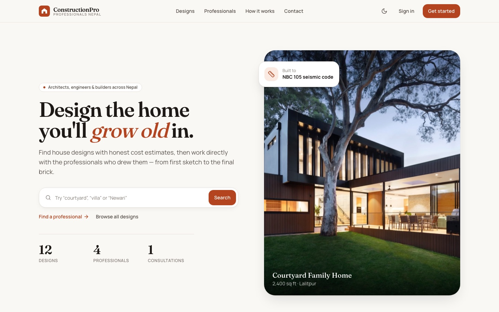
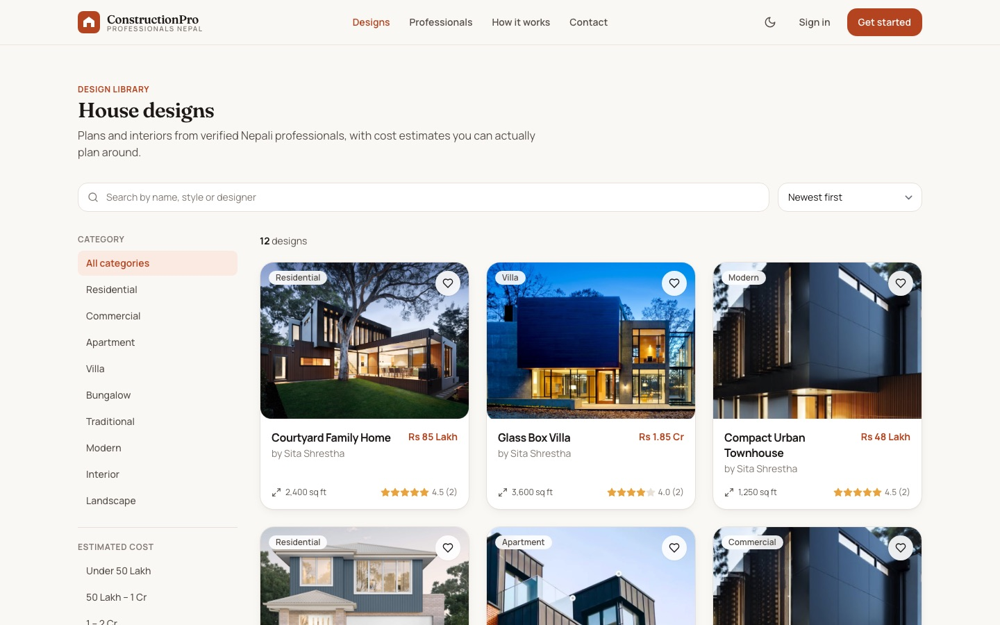
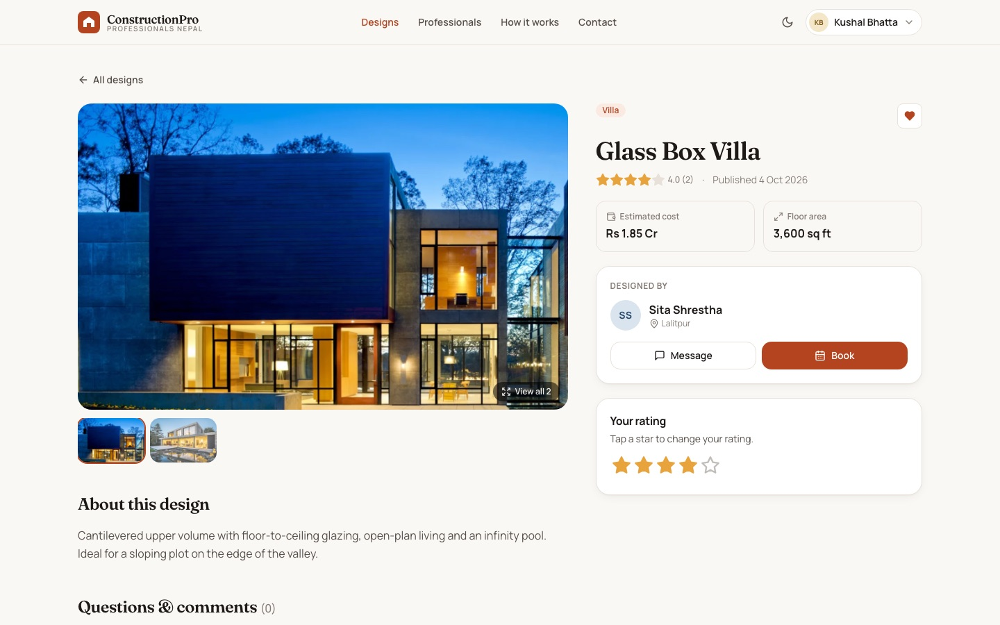
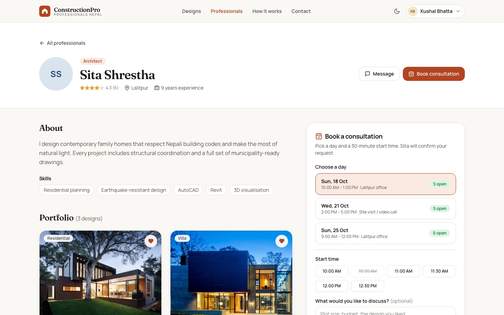
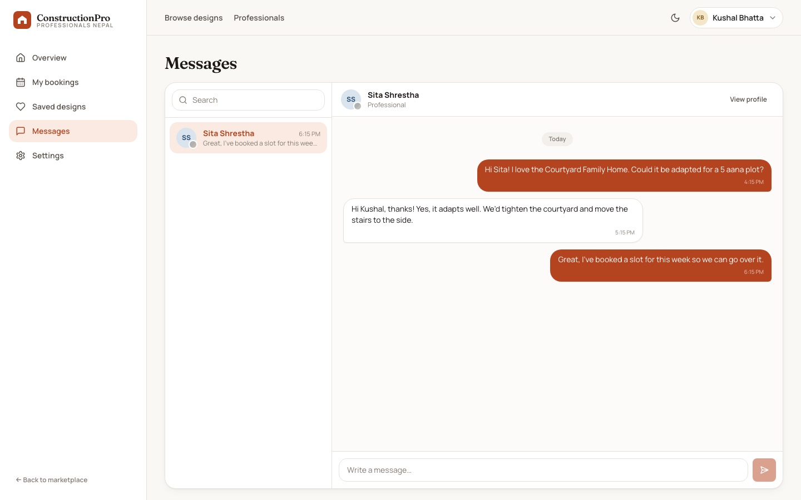
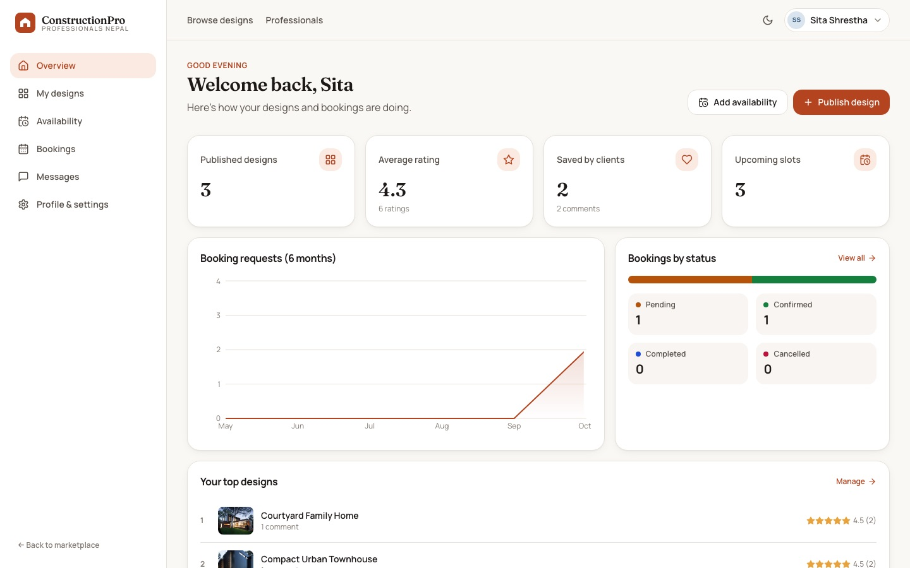
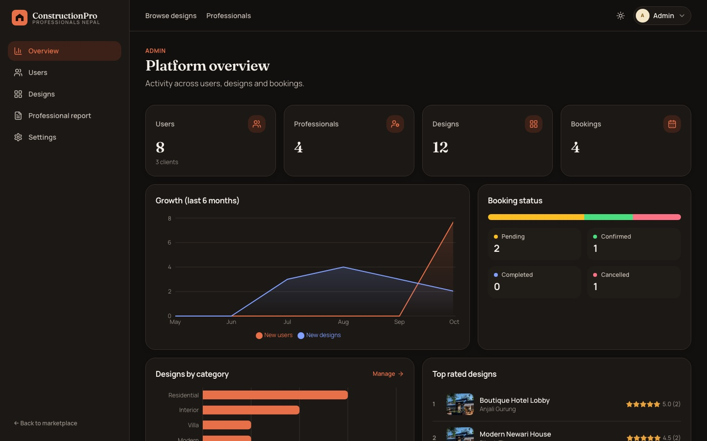
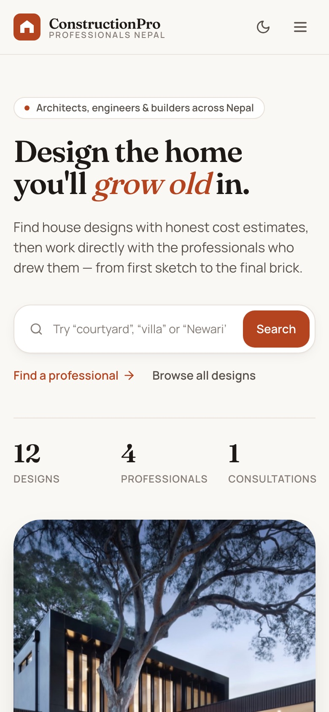
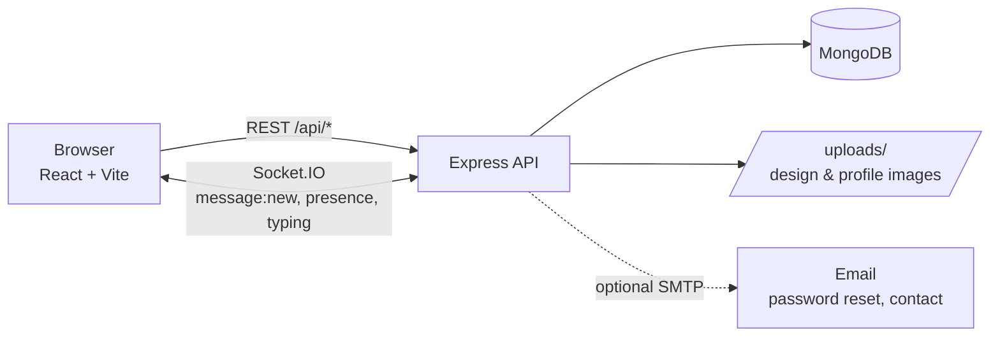

<div align="center">

# ConstructionPro · Professionals Nepal

**A marketplace where families in Nepal find house designs with honest cost estimates, and book the architects, engineers, interior designers and contractors who drew them.**

[](https://github.com/kushal721/Construction-Professionals-Nepal/actions/workflows/ci.yml)




</div>

## Contents

- [Features](#features)
- [Screenshots](#screenshots)
- [Tech stack](#tech-stack)
- [Getting started](#getting-started)
- [Configuration](#configuration)
- [Project structure](#project-structure)
- [API reference](#api-reference)
- [Testing](#testing)
- [Security](#security)

## Features

### For clients
- **Design library** with server-side search, category, budget and floor-area filters, sorting and pagination, all reflected in the URL so results can be shared.
- **Design pages** with a photo gallery and lightbox, cost and area at a glance, star ratings (changeable later), and a Q&A comment thread.
- **Saved designs**: one-tap favourites, synced to your account.
- **Book consultations**: pick a day from the professional's published availability and a free 30-minute start time; already-taken times are greyed out.
- **Real-time messaging** with any professional, with online status and typing indicators.

### For professionals
- **Portfolio management**: publish and edit designs with up to 10 photos (drag and drop; the first photo is the cover).
- **Availability**: publish consultation windows by date, time and location.
- **Booking pipeline**: confirm, decline, complete or cancel requests; client contact details appear once confirmed.
- **Public profile** with specialization, experience, education and skills.
- **Dashboard** with ratings, saves, booking trends and top designs.

### For admins
- **Platform analytics**: user and design growth, designs by category, booking status.
- **Moderation**: search, filter and remove users and designs (removing a user cleans up everything they own).
- **Professional report**: expandable per-professional breakdown with **CSV export** and a print-friendly layout.

### Everywhere
- Light and dark themes, a responsive layout from 360px phones up, keyboard-accessible dialogs and menus, and loading, empty and error states on every screen.

## Screenshots

| Design library | Design detail |
| --- | --- |
|  |  |
| **Professional profile & booking** | **Real-time messages** |
|  |  |
| **Professional dashboard** | **Admin overview (dark mode)** |
|  |  |

<p align="center"></p>

## Tech stack

| Layer    | Technology |
| -------- | ---------- |
| Frontend | React 18, Vite, React Router, TanStack Query, Tailwind CSS, Recharts, lucide-react, sonner |
| Backend  | Node.js, Express, Mongoose, JWT auth, bcryptjs, Multer (image uploads), Nodemailer |
| Realtime | Socket.IO on the same server and port as the API, with JWT-authenticated connections |
| Database | MongoDB 7 |
| Tooling  | Docker Compose (MongoDB), GitHub Actions CI |



## Getting started

**Requirements:** Node.js 18+ and Docker (or any MongoDB on `localhost:27017`).

```bash
git clone https://github.com/kushal721/Construction-Professionals-Nepal.git
cd Construction-Professionals-Nepal

npm run setup                          # install backend + web dependencies
cp backend/.env.example backend/.env   # set JWT_SECRET_KEY to a long random string
npm run db                             # start MongoDB in Docker
npm run seed                           # load demo data (wipes existing app data)

npm run api                            # terminal 1: API on http://localhost:4000
npm run web                            # terminal 2: app on http://localhost:5173
```

### Demo accounts

Every seeded account uses the password **`Password123`**.

| Role         | Email |
| ------------ | ----- |
| Client       | `client@cpn.test` (also `priya@`, `nabin@`) |
| Professional | `sita@cpn.test` (also `ramesh@`, `anjali@`, `bikash@`) |
| Admin        | `admin@cpn.test` |

> In development the login page has a **Demo accounts** shortcut that fills these in.

### Scripts

| Command (repo root) | What it does |
| ------------------- | ------------ |
| `npm run setup` | Install dependencies for `backend/` and `web/` |
| `npm run db`    | Start MongoDB with Docker Compose |
| `npm run seed`  | Reset and seed demo users, designs, availability, bookings and a chat |
| `npm run api`   | Start the API with file watching |
| `npm run web`   | Start the Vite dev server (proxies `/api`, `/uploads`, `/socket.io` to the API) |
| `npm run build` | Production build of the web app into `web/dist` |

## Configuration

`backend/.env` (see [`backend/.env.example`](backend/.env.example)):

| Variable | Required | Description |
| -------- | -------- | ----------- |
| `JWT_SECRET_KEY` | ✅ | Secret used to sign session and reset tokens |
| `DATABASE_URL` | ✅ | MongoDB connection string, e.g. `mongodb://127.0.0.1:27017` |
| `DATABASE_NAME` | | Database name (default `construction-professionals-nepal`) |
| `PORT` | | API port (default `4000`) |
| `REACT_FRONTEND` | | Comma-separated allowed frontend origins; the first is used in email links |
| `EMAIL_HOST`, `EMAIL_PORT`, `EMAIL_USER`, `EMAIL_PASS`, `EMAIL_FROM` | | SMTP settings. **When unset, emails such as reset links are printed to the API console.** |
| `CONTACT_EMAIL` | | Inbox for contact-form messages (defaults to `EMAIL_FROM`) |

`web/.env` is only needed when the API is on a different origin in production: set `VITE_API_URL=https://api.example.com`.

## Project structure

```
.
├── backend/
│   ├── config/          # MongoDB connection, mailer
│   ├── controllers/     # auth, users, professionals, designs, favorites, appointments, chat, stats, contact
│   ├── middlewares/     # JWT auth + role guards, image uploads
│   ├── models/          # Mongoose schemas
│   ├── routes/index.js  # every API route in one place
│   ├── services/        # Socket.IO realtime server
│   ├── seed/            # demo data + images
│   └── test/            # end-to-end API checks
├── web/
│   └── src/
│       ├── components/  # UI kit (ui/), layouts, design & professional cards
│       ├── context/     # auth, theme, realtime
│       ├── hooks/       # useFavorites
│       ├── lib/         # API client, formatting (NPR lakh/crore, dates)
│       └── pages/       # public/, auth/, dashboard/ (+ admin/)
├── docs/screenshots/
└── docker-compose.yml
```

## API reference

Base path `/api`. Authenticated routes expect `Authorization: Bearer <token>`. Errors are returned as `{ "message": "..." }` with an appropriate status code.

<details>
<summary><strong>Auth & users</strong></summary>

| Method | Path | Access | Description |
| ------ | ---- | ------ | ----------- |
| POST | `/auth/register` | public | Create a client or professional account (multipart, optional `profile` image) |
| POST | `/auth/login` | public | Returns `{ token, user }` |
| GET | `/auth/me` | user | Current user |
| PUT | `/auth/password` | user | Change password |
| POST | `/auth/forgot-password` | public | Email a 15-minute, single-use reset link |
| POST | `/auth/reset-password/:id/:token` | public | Set a new password |
| PUT | `/users/me` | user | Update profile (multipart) |
| GET | `/users/:id` | public | Public profile fields |
| GET | `/users?role=&q=` | admin | List users |
| DELETE | `/users/:id` | admin | Delete a user and their content |

</details>

<details>
<summary><strong>Professionals & designs</strong></summary>

| Method | Path | Access | Description |
| ------ | ---- | ------ | ----------- |
| GET | `/professionals?q=&specialization=&location=` | public | List with details, design count and rating |
| GET | `/professionals/:id` | public | Profile, designs and upcoming availability |
| GET / PUT | `/professionals/me/details` | professional | Read / upsert specialization, experience, skills... |
| GET | `/designs` | public | `q, category, minCost, maxCost, minArea, maxArea, designer, sort, page, limit` |
| GET | `/designs/categories` | public | Category list |
| GET | `/designs/:id` | public | Detail with designer, comments, related designs, and your rating/favourite when signed in |
| GET | `/designs/mine` | professional | Your designs |
| POST | `/designs` | professional | Create (multipart `designImages[]`) |
| PATCH | `/designs/:id` | owner / admin | Update; `keepImages` JSON selects existing images to keep |
| DELETE | `/designs/:id` | owner / admin | Delete |
| PUT | `/designs/:id/rating` | user | Rate 1–5 (create or update) |
| POST / PATCH / DELETE | `/designs/:id/comments[/:commentId]` | user | Comment CRUD (author edits; author, design owner or admin deletes) |
| GET | `/favorites`, `/favorites/ids` | user | Saved designs |
| POST / DELETE | `/favorites/:designId` | user | Save / unsave |

</details>

<details>
<summary><strong>Availability, bookings & messaging</strong></summary>

| Method | Path | Access | Description |
| ------ | ---- | ------ | ----------- |
| GET | `/professionals/:id/slots` | public | Upcoming slots with already-booked times |
| GET | `/slots/mine` | professional | Your slots with booking counts |
| POST / PATCH / DELETE | `/slots[/:id]` | professional | Manage availability (deleting cancels active bookings) |
| GET | `/bookings?status=` | user | Your bookings (as client or professional) |
| POST | `/bookings` | client | `{ slotId, time, remark }`, validated against the window and existing bookings |
| PATCH | `/bookings/:id/status` | participant | Allowed transitions: professional confirms / declines / completes; either side cancels |
| DELETE | `/bookings/:id` | participant | Remove a cancelled or completed booking |
| GET / POST | `/chats` | user | List conversations / open one with `{ userId }` |
| GET / POST | `/chats/:id/messages` | member | Read / send; new messages are pushed over Socket.IO as `message:new` |

</details>

<details>
<summary><strong>Stats & misc</strong></summary>

| Method | Path | Access | Description |
| ------ | ---- | ------ | ----------- |
| GET | `/stats/public` | public | Counts for the home page |
| GET | `/stats/dashboard` | user | Role-specific dashboard data |
| GET | `/admin/report` | admin | Professionals with details, designs and booking counts |
| POST | `/contact` | public | Contact form |
| GET | `/health` | public | Health check |

</details>

## Testing

With the API running against freshly seeded data:

```bash
cd backend
npm run seed -- --reset
npm test        # 40 end-to-end checks: auth, permissions, search, bookings, chat, stats
```

CI runs the same checks against a MongoDB service container and builds the web app on every push and pull request.

## Security

- Passwords are hashed with bcrypt and never returned by the API.
- Every write checks authentication, role and ownership on the server; user identity always comes from the token, never from the request body.
- Password-reset tokens expire after 15 minutes and stop working once the password changes.
- Login and reset responses don't reveal whether an email is registered.
- Uploads are limited to JPG, PNG and WEBP images up to 5 MB.
- Secrets live in `.env`, which is git-ignored. Only `.env.example` is committed.
